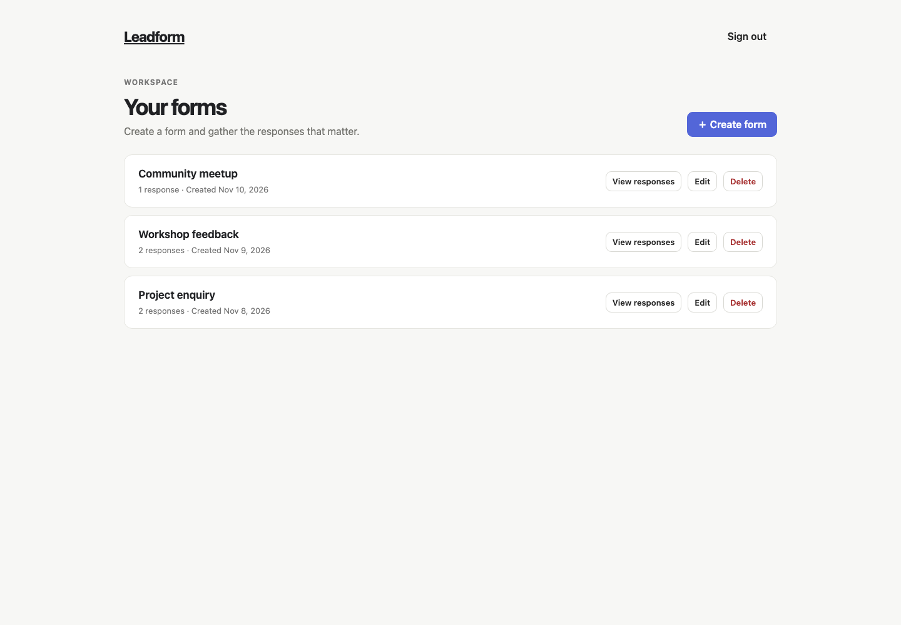

# Leadform

A single-owner form builder for enquiries, feedback and registrations.

**Product inspiration:** Form-building workflows: conditional questions, public forms and response collection.

**Neander library:** Leadform · **Category:** Forms & Surveys



## What you can build

- Create and style forms using several question types.
- Use conditional branching to guide respondents.
- Share public forms and preview drafts.
- Collect responses and export them to CSV.

## How this fits into Neander

This is the open-source app behind Neander’s **Leadform** starter. You can
run and modify it on its own without a Neander account, or use it as a starting
point in Neander.

1. Choose **Use Template** in [Neander](https://neander.ai).
2. Neander creates a normal project from a registered version of this repository,
   with fresh Git history, and publishes a working app with sample data.
3. Open the live app and continue in the project. Prompt Neander to make changes
   in the codebase, just as you would in any other project.
4. Use **Publish** again when you want your changes reflected in the live app.

Your project starts from one version. Later changes to this repository or the
template library do not overwrite your project. Linked IDE projects use their
checkout; web projects use Neander’s managed project source.

## Run locally

Stack: Node.js, Express, PostgreSQL and a browser JavaScript client.

Use **Node 22.23.2** and the npm version supplied with Node. Versions are listed in
`mise.toml`; if you use mise, run `mise install`. Install Docker for the local
PostgreSQL service.

### 1. Install the app

```sh
git clone https://github.com/neanderhq/leadform.git
cd leadform
npm ci
cp .env.example .env
```

### 2. Start local PostgreSQL

```sh
docker run --detach --name leadform-dev-postgres \
  --publish 127.0.0.1:55490:5432 \
  --env POSTGRES_USER=neander_dev --env POSTGRES_PASSWORD=neander_dev_only \
  --env POSTGRES_DB=neander_dev \
  --volume leadform-dev-postgres:/var/lib/postgresql/data \
  postgres:16-alpine
```

Wait for PostgreSQL to be ready before the next step:

```sh
docker exec leadform-dev-postgres pg_isready -U neander_dev -d neander_dev
```

### 3. Configure the app

Edit `.env`. The database URL is already set for the local service above.

| Variable | Purpose |
| --- | --- |
| `DATABASE_URL` | PostgreSQL connection used by this local app. |
| `OWNER_PASSWORD` | Your unique password for the `admin` owner account. |
| `SESSION_SECRET` | A random secret used for owner sessions. |

Generate a value for each blank secret and paste it into the environment file:

```sh
node -e "console.log(require('node:crypto').randomBytes(32).toString('base64url'))"
```

These database credentials are for the loopback development service. Neander
supplies a managed database connection and generated runtime secrets when it
publishes a project. Keep your local environment file out of Git.

### 4. Initialize and start

```sh
npm run db:seed
npm run dev
```

Open **http://127.0.0.1:3000**.

Sign in as **`admin`** with the `OWNER_PASSWORD` you configured.

### Try the form flow

Open **Project enquiry**, edit a question, then use its public form link to submit a response. Return to **View responses** to inspect or export the result.

## Sample data

Three fictional forms—Project enquiry, Workshop feedback and Community meetup—with five example responses.

All sample people, organizations and responses are fictional. Seed retries preserve
existing changes and credentials. Normal app restarts do not reset your data.

## Development and checks

```sh
npm run check
npm test
npm run build
```

Public CI runs these app checks and a production build without Neander’s private
publishing tools or cloud credentials. Full template image/database verification
and library publication are run manually by Neander maintainers in private CI.
Merging a contribution does not automatically update the template library.

## Repository layout

| Path | Purpose |
| --- | --- |
| `server.js` | HTTP routes, owner login, form/response APIs and server startup. |
| `public/` | Form builder and public-form browser UI. |
| `db/` | PostgreSQL initializer and versioned SQL schema. |
| `.neander/template.yaml` | Library metadata and install/check/test/seed commands. |
| `.neander/compose.yaml` | Normal Neander Publish recipe and runtime requirements. |
| `.neander/seed.mjs` | Fictional demo initializer. |
| `scripts/verify-template.mjs` | Maintainer verification of the built app image. |

## Maintaining the Neander template

The `.neander/template.yaml` manifest defines the library entry and verification
commands. `.neander/compose.yaml` defines the app’s normal Publish recipe,
including PostgreSQL, migrations and generated secrets. Keep these files in sync
when changing database, authentication or runtime requirements.

Neander’s private release workflow checks out an exact GitHub commit, verifies
the built app with a disposable database, and registers its image and metadata.
The application source stays in this repository.

## Contributing

Fork the repository, make a focused change, and run the checks above before
opening a pull request. Include the behavior you changed and how you verified it.
A maintainer decides when to publish a new version to Neander’s library.

## License

[MIT](LICENSE). Third-party components retain their respective licenses and
existing attribution notices.

## Security

See [SECURITY.md](SECURITY.md) for private vulnerability reporting and the automated security checks.

Set `APP_ORIGIN` to the app’s public origin (for local development, `http://127.0.0.1:8080`). Owner mutations require this Origin.

## Contributing and checks

Use the pinned tools in `mise.toml`. Run `npm run verify` for source validation;
see [development setup](docs/development.md) and [verification coverage](docs/testing.md)
for production-image tests and CI. Work through a feature branch and PR; preserve
the existing application, deployment recipe, fictional seeds and MIT license.
